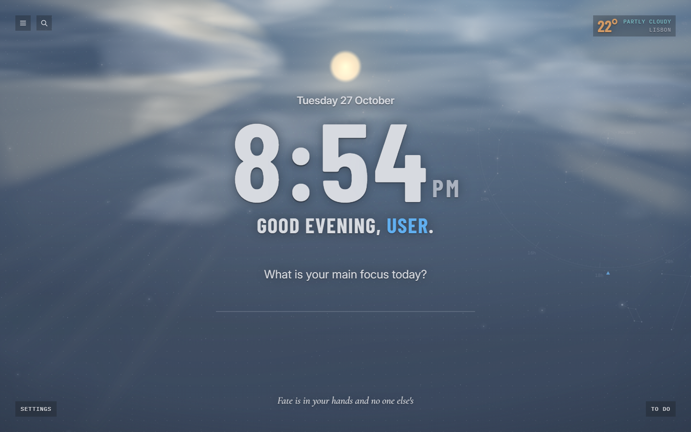
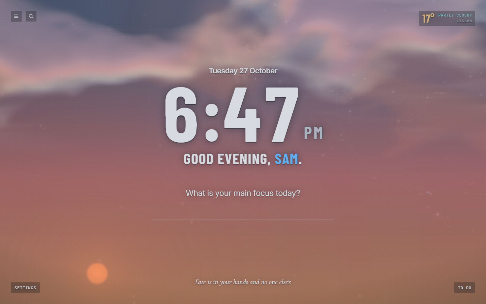
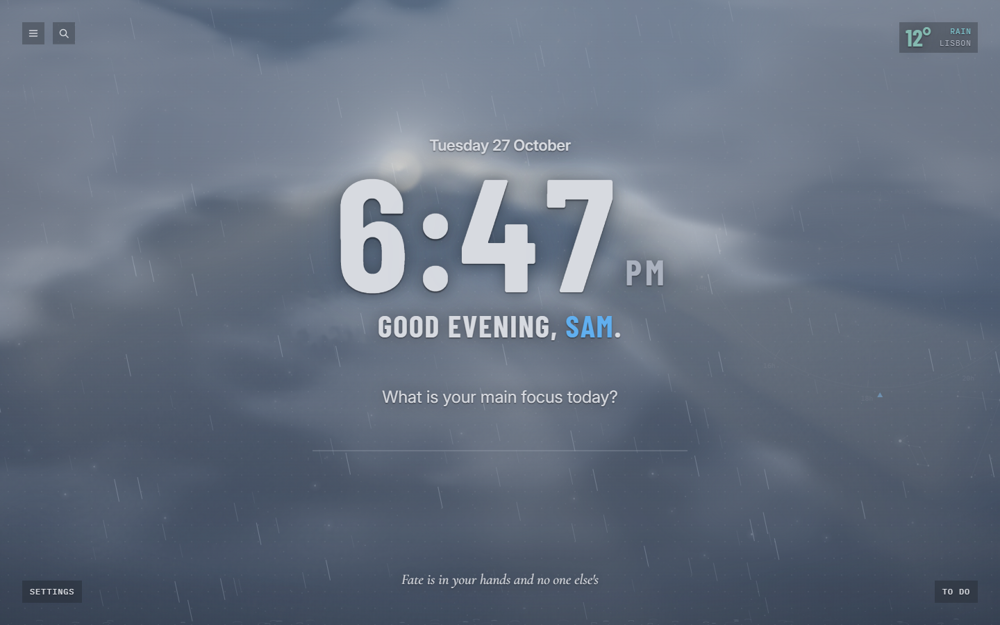
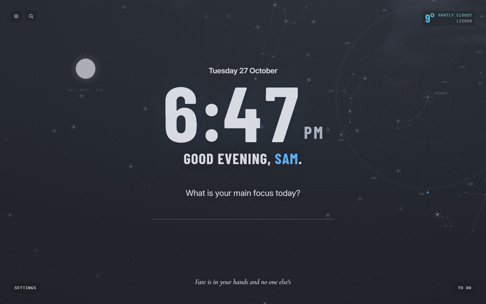
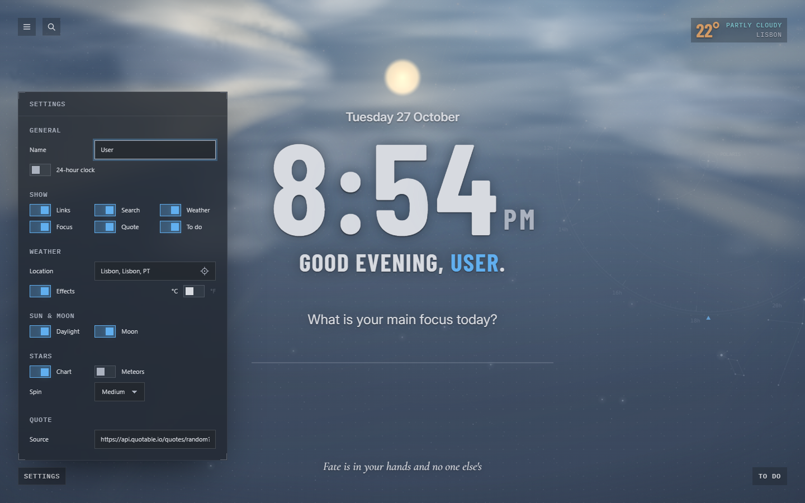

# Nightglass

A browser theme and new tab page for Chrome and Brave, in One Dark colors.

The new tab has a clock, a daily focus, to-dos, links, weather and a quote. The background is a star chart with the sun, moon and current weather drawn on top.

[Try the new tab in your browser](https://github.wxyben.dev/nightglass/). The demo stores its settings in the page instead of syncing them.



| | |
| --- | --- |
|  |  |
|  |  |

## Contents

| Folder | Contents |
| --- | --- |
| `theme/` | Browser theme: dark slate frame with stars, an hour tape and a small compass in the tab strip |
| `newtab/` | New tab page extension |
| `tools/` | Scripts for exporting, screenshots and rendering the theme image |
| `docs/` | Screenshots and the day/night color sheet |

The theme and new tab are separate extensions because browser themes only support colors and images. They can't run code or replace the new tab page.

## Install

Download `nightglass-theme.zip` and `nightglass-new-tab.zip` from the [latest release](https://github.com/Xiaoyu-Ben-Wang/nightglass/releases/latest) and unzip them. Open `chrome://extensions` (or `brave://extensions`), turn on Developer mode, click **Load unpacked**, and select each unzipped folder.

To load from the repo instead:

```bash
pnpm install
pnpm run build
```

Then load `theme/` and `newtab/` the same way. After editing `newtab/src/`, run the build again and reload the extension.

To install a copy outside the repo:

```bash
pnpm run export
```

This writes both extensions to `~/DevApps/Nightglass`, replacing any previous copy. Set `EXPORT_DIR` to use another folder.

## Features

### Sky

- Star chart of the northern sky, rotating around Polaris. Speed is set in Settings → Stars.
- Sky color changes with the sun's elevation, from night through sunrise to day (see `docs/day-night-cycle.png`).
- The sun moves across the screen during the day based on your location and the time.
- The moon shows its current phase after sunset.

### Weather

Weather comes from [Open-Meteo](https://open-meteo.com). Depending on conditions, the page draws clouds, fog, rain, snow, hail or lightning. Rain is angled by the wind speed.

The temperature's color depends on the temperature: blue when cold, yellow when warm, red when hot.

### Clouds and sunlight

Clouds are simulated as fluid on the GPU in three layers. Moving the mouse pushes them around; they return to their original shape over about ten seconds.

Lighting is calculated by tracing light from the sun through the clouds:

- Sides of clouds facing the sun are brighter.
- Thin clouds near the sun have bright edges.
- The sun is dimmed by clouds in front of it.
- Gaps between clouds produce light rays.
- The clock's digits block the sun when it's behind them, with light rays between them.
- Clouds turn orange and pink at sunrise and sunset.

Rendering takes about 1 ms per frame.

### Widgets

- **Greeting:** asks for your name on first run. Double-click the name to change it.
- **Clock:** uses the time zone of your weather location.
- **Focus and to-dos:** stored on this device. The focus resets each day.
- **Links:** opened with the menu icon. Synced across devices.
- **Search:** opened with the magnifier icon or `/`. Uses the browser's default search engine.
- **Quote:** a new quote each day. Clicking it searches for the quote.

### Settings

| Section | Options |
| --- | --- |
| General | Name, 24-hour clock |
| Show | Which widgets appear |
| Weather | Location, weather effects, °C/°F |
| Sun & moon | Daylight colors, moon |
| Stars | Chart, meteors, rotation speed |
| Quote | Quote source |

Settings and links sync through `chrome.storage.sync`.

## How it works

The page has four layers, back to front:

1. Star chart (`vendor/backdrops/sky.js`, 2D canvas)
2. Sunrise and sunset gradient (CSS)
3. Fog, rain, snow, hail and lightning (`scene.ts`, 2D canvas)
4. Sun and clouds (`atmosphere.ts`, WebGL2)

| Module | Purpose |
| --- | --- |
| `main.ts` | Loads settings and starts each widget |
| `daylight.ts` | Sun position and sky colors |
| `scene.ts` | Maps weather codes to effects, draws precipitation, runs the animation loop |
| `atmosphere.ts`, `text-mask.ts` | Cloud simulation, sun and lighting; the clock's digits as a shadow mask |
| `weather.ts` | Fetches weather, cached for 30 minutes |
| `location.ts` | Location detection and city lookup |
| `moon.ts` | Moon phase |
| `clock.ts`, `focus.ts`, `todos.ts`, `links.ts`, `quotes.ts` | Widgets |
| `panels.ts`, `settings-form.ts`, `search.ts` | Corner controls |
| `settings.ts`, `store.ts` | Settings and storage |
| `math.ts`, `motion.ts`, `dom.ts`, `time.ts` | Shared helpers |

The animation loop pauses when there's no weather to animate. With reduced motion enabled, the sky is drawn as a still image and UI animations only fade.

## Development

To work without reloading the extension, serve the repo root (`python -m http.server`) and open `/newtab/newtab.html`. Outside the extension, settings are stored in `localStorage`.

URL parameters for testing the sky:

| Parameter | Effect |
| --- | --- |
| `sun=<degrees>` | Sets the sun's elevation, e.g. `sun=-6` for twilight |
| `sunx=<0..1>` | Sets the sun's horizontal position |
| `weather=<code>` | Sets the [WMO weather code](https://open-meteo.com/en/docs#weather_variable_documentation), e.g. `0` clear, `2` partly cloudy, `3` overcast, `45` fog, `63` rain, `75` snow, `99` thunderstorm with hail |
| `day=0` | Uses night for the set weather |
| `wind=<km/h>` | Sets the wind speed |
| `seed=<number>` | Uses a fixed cloud layout |

| Script | Description |
| --- | --- |
| `pnpm run build` | Compiles `newtab/src` to `newtab/dist` |
| `pnpm run watch` | Compiles on change |
| `pnpm run check` | Type-checks |
| `pnpm run export` | Builds and copies both extensions out of the repo |
| `pnpm run release` | Writes both extension zips and the demo site to `release/` |
| `pnpm run pages` | Pushes `release/site/` to the `gh-pages` branch |
| `pnpm run screenshots` | Regenerates `docs/screenshots/` (run `build` first) |
| `pnpm run frame` | Renders the theme's frame image |

The scripts look for Chrome or Brave in the default install locations. Set `CHROME` to use a different path.

### Theme frame image

`theme/images/theme_frame.png` and `theme_frame@2x.png` are rendered from `tools/frame.html`. Its query options are `px` and `py` (compass position), `top` (where drawing starts) and `shade` (darkness), e.g. `node tools/render-frame.ts "px=1400&shade=0.45"`.

The browser draws the frame image about 16px above the tab strip, so drawing starts at `top=16`. After changing the images, increase the theme's `version` and delete `theme/Cached Theme.pak`, or the browser keeps the old images.

### Vendored files

`newtab/vendor/` contains files copied from the `theme-design-systems` repo: `tokens/base.css`, `components/components.css`, `themes/nightglass.css`, `backdrops/_core.js` and `backdrops/sky.js`. `newtab/onedark.css` overrides their colors.

`sky.js` has one local change: it keeps its rotation angle when the speed changes. Keep this change when updating it.

## Data and licenses

- **Weather:** [Open-Meteo](https://open-meteo.com), no API key needed.
- **Location:** from the browser, checked every 6 hours, and named with BigDataCloud's reverse geocoding. A city entered in Settings replaces it until you click the location button.
- **Quotes:** from a [Quotable](https://github.com/lukepeavey/quotable)-compatible API, cached for the day. Quotable's public server has been offline since September 2024, so quotes come from the bundled list unless you set another source.
- **Bundled quotes:** `newtab/data/quotes.json` has 1,581 quotes from [dwyl/quotes](https://github.com/dwyl/quotes) (GPL-2.0), [inspirational-quotes](https://github.com/vinitshahdeo/inspirational-quotes) (MIT) and [DummyJSON](https://github.com/Ovi/DummyJSON) (MIT). Licenses are in `newtab/data/licenses/`. Because one source is GPL-2.0, the quote file is distributed under GPL-2.0.
